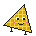

# Tri's Lab by FEAScript

Tri's Lab by FEAScript is a playful place to discover the finite element method, the technique engineers use to simulate how heat spreads, how fluids flow and how structures bend. It is made for students and curious beginners: you don't need to know the maths or write any code. Tri, a small triangle robot, shows you around.

Everything runs in your browser, and every result is a real simulation, solved by [FEAScript](https://feascript.com), the open-source finite element library in JavaScript.

There are two ways to play:

- **Critical Mesh**, a pixel-art game. You are the night engineer of a city's power plant: place heat cells on a metal plate, deliver the power the city needs and keep the plate from overheating.
- **FEM Blocks**. Snap blocks together to build a simulation, then take on short missions that each teach one idea.

**Play it at [lab.feascript.com](https://lab.feascript.com).** No install, no account.

## Sitemap

`python3 scripts/update-sitemap.py` sets each `<lastmod>` in `sitemap.xml` to the date the page last changed in git (today, if it has uncommitted changes). The pre-commit hook in `.githooks/` runs it on every commit (the prepare-commit-msg hook there adds the `Signed-off-by` trailer); enable them once per clone with `git config core.hooksPath .githooks`. When you add a page that should be indexed, add its `<url>` entry by hand; pages with `noindex` stay out.

## License

Tri's Lab is code, writing and art, and each has its own terms:

| What | License |
|---|---|
| Code: everything not listed in the rows below | [MIT](LICENSE) |
| Writing and art: the story, dialogue and cast (`critical-mesh/js/story.js`), the Field Notes (`critical-mesh/js/codex.js`), the mission texts (`blocks/js/missions.js`), the pixel art (`critical-mesh/js/art.js`, `blocks/js/pixels.js`), the screenshots (`assets/*.png`) and the READMEs | [CC BY 4.0](LICENSE-CONTENT) |
| Tri (the character and its design, wherever it appears), the FEAScript logo, and the names "FEAScript" and "Tri's Lab" | Not licensed, all rights reserved |

In the files that mix code and writing or art, the code is MIT and the writing and art are CC BY 4.0; each of those files says so in its header. Credit CC BY material as: *"Tri's Lab by FEAScript (lab.feascript.com), CC BY 4.0"*, and note any changes you made.

**Tri and the FEAScript marks.** You may use Tri, the logos and the names, unchanged, when you refer to FEAScript or Tri's Lab: in a lesson, a talk, a blog post, or a fork that says where it comes from. For anything else (merchandise, a product or service, another project's mascot), please ask first at info@feascript.com. A fork you redistribute should replace Tri and the logos, or say clearly that it is not the official Tri's Lab.

Third-party software that Tri's Lab by FEAScript loads at runtime is listed in [NOTICE.md](NOTICE.md).
